# Домашнее задание к занятию «Вычислительные мощности. Балансировщики нагрузки»  - Студент группы FOPS-42 Власов Владимир

### Подготовка к выполнению задания

1. Домашнее задание состоит из обязательной части, которую нужно выполнить на провайдере Yandex Cloud, и дополнительной части в AWS (выполняется по желанию). 
2. Все домашние задания в блоке 15 связаны друг с другом и в конце представляют пример законченной инфраструктуры.  
3. Все задания нужно выполнить с помощью Terraform. Результатом выполненного домашнего задания будет код в репозитории. 
4. Перед началом работы настройте доступ к облачным ресурсам из Terraform, используя материалы прошлых лекций и домашних заданий.

---
## Задание 1. Yandex Cloud 

**Что нужно сделать**

1. Создать бакет Object Storage и разместить в нём файл с картинкой:

 - Создать бакет в Object Storage с произвольным именем (например, _имя_студента_дата_).
 - Положить в бакет файл с картинкой.
 - Сделать файл доступным из интернета.
 
2. Создать группу ВМ в public подсети фиксированного размера с шаблоном LAMP и веб-страницей, содержащей ссылку на картинку из бакета:

 - Создать Instance Group с тремя ВМ и шаблоном LAMP. Для LAMP рекомендуется использовать `image_id = fd827b91d99psvq5fjit`.
 - Для создания стартовой веб-страницы рекомендуется использовать раздел `user_data` в [meta_data](https://cloud.yandex.ru/docs/compute/concepts/vm-metadata).
 - Разместить в стартовой веб-странице шаблонной ВМ ссылку на картинку из бакета.
 - Настроить проверку состояния ВМ.
 
3. Подключить группу к сетевому балансировщику:

 - Создать сетевой балансировщик.
 - Проверить работоспособность, удалив одну или несколько ВМ.
4. (дополнительно)* Создать Application Load Balancer с использованием Instance group и проверкой состояния.

Полезные документы:

- [Compute instance group](https://registry.terraform.io/providers/yandex-cloud/yandex/latest/docs/resources/compute_instance_group).
- [Network Load Balancer](https://registry.terraform.io/providers/yandex-cloud/yandex/latest/docs/resources/lb_network_load_balancer).
- [Группа ВМ с сетевым балансировщиком](https://cloud.yandex.ru/docs/compute/operations/instance-groups/create-with-balancer).

---
## Задание 2*. AWS (задание со звёздочкой)

Это необязательное задание. Его выполнение не влияет на получение зачёта по домашней работе.

**Что нужно сделать**

Используя конфигурации, выполненные в домашнем задании из предыдущего занятия, добавить к Production like сети Autoscaling group из трёх EC2-инстансов с  автоматической установкой веб-сервера в private домен.

1. Создать бакет S3 и разместить в нём файл с картинкой:

 - Создать бакет в S3 с произвольным именем (например, _имя_студента_дата_).
 - Положить в бакет файл с картинкой.
 - Сделать доступным из интернета.
2. Сделать Launch configurations с использованием bootstrap-скрипта с созданием веб-страницы, на которой будет ссылка на картинку в S3. 
3. Загрузить три ЕС2-инстанса и настроить LB с помощью Autoscaling Group.

Resource Terraform:

- [S3 bucket](https://registry.terraform.io/providers/hashicorp/aws/latest/docs/resources/s3_bucket)
- [Launch Template](https://registry.terraform.io/providers/hashicorp/aws/latest/docs/resources/launch_template).
- [Autoscaling group](https://registry.terraform.io/providers/hashicorp/aws/latest/docs/resources/autoscaling_group).
- [Launch configuration](https://registry.terraform.io/providers/hashicorp/aws/latest/docs/resources/launch_configuration).

Пример bootstrap-скрипта:

```
#!/bin/bash
yum install httpd -y
service httpd start
chkconfig httpd on
cd /var/www/html
echo "<html><h1>My cool web-server</h1></html>" > index.html
```
### Правила приёма работы

Домашняя работа оформляется в своём Git репозитории в файле README.md. Выполненное домашнее задание пришлите ссылкой на .md-файл в вашем репозитории.
Файл README.md должен содержать скриншоты вывода необходимых команд, а также скриншоты результатов.
Репозиторий должен содержать тексты манифестов или ссылки на них в файле README.md.

## Выполнение задания 1. Yandex Cloud 

1. Для того что бы создать бакет Object Storage и разместить в нём файл с картинкой, для этого:

- добавляем права доступа для сервисного аккаунта;
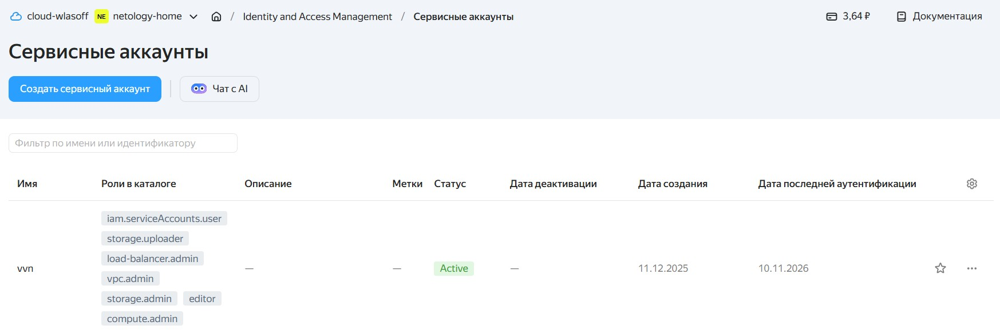

- создаем бакет в Object Storage с произвольным именем (например, _имя_студента_дата_);

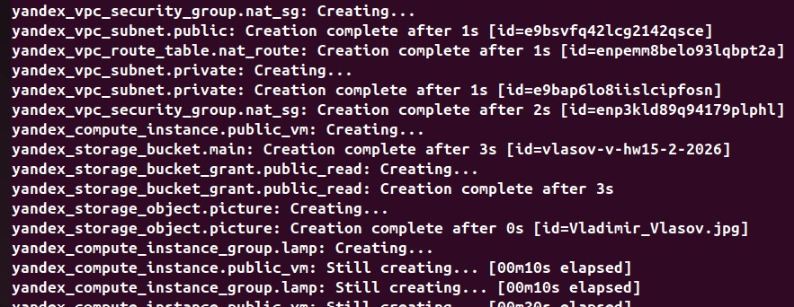

- выгрузим в бакет файл с картинкой;

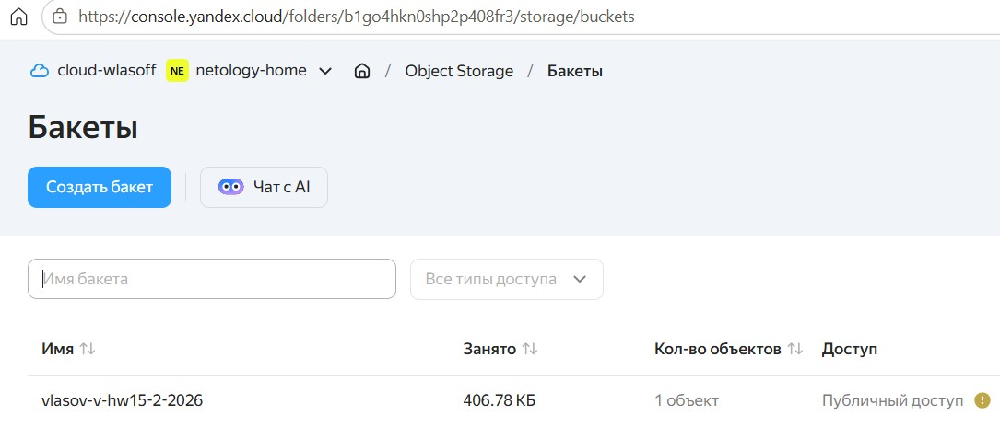
 
- сделаем картинку доступной из интернета;


[<Тут конфигурация Bucket'a>](./cfg/bucket.tf)


- Права доступа на картинку;

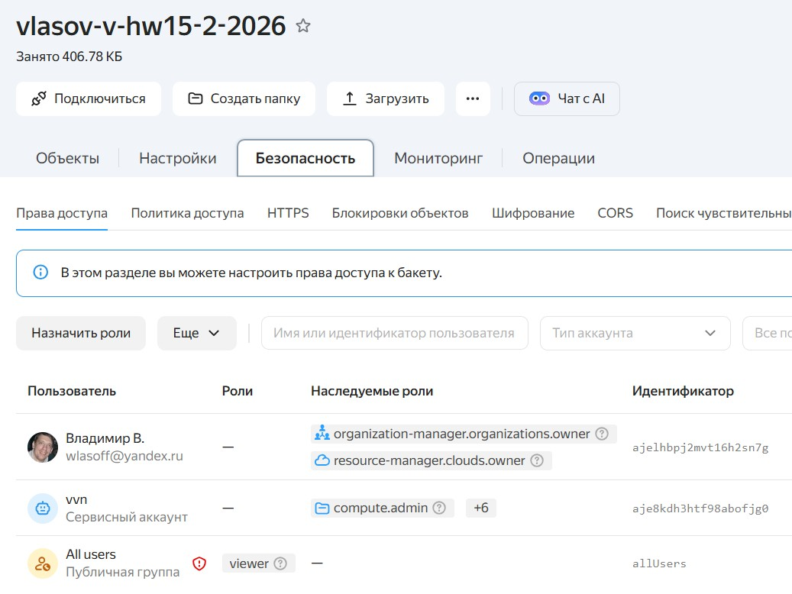

2. Создаем группу ВМ в public подсети фиксированного размера с шаблоном LAMP и веб-страницей, содержащей ссылку на картинку из бакета:

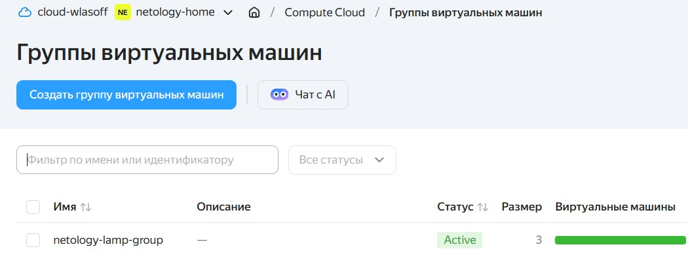

 - Создаtv Instance Group с тремя ВМ и шаблоном LAMP, где для LAMP рекомендуется использовать `image_id = fd827b91d99psvq5fjit`.
 
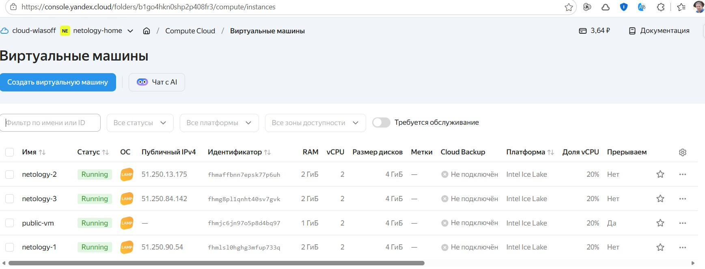
 
 - Для создания стартовой веб-страницы рекомендуется использовать раздел `user_data` в [meta_data](https://cloud.yandex.ru/docs/compute/concepts/vm-metadata).
 
[Задаем параметры cloud-init ](./conf/instance-group.tf)

- При помощи cloud-init задаем насройку при первом запуске VM  где   <h1>LAMP Instance Group</h1>
      

 - Размещаем в стартовой веб-странице шаблонной ВМ ссылку на картинку из бакета.
 
После запуска ВМ страница c картинкой доступна по http://51.250.90.54/


или по http://51.250.13.175/


или по http://51.250.84.142/


Запись производится в корень index.html
 ```
 write_files:
  - path: /var/www/html/index.html
    content: |
 ```

 - Настроим проверку состояния ВМ.

Прописывается в instance-group.tf
```

  health_check {
    interval            = 5
    timeout             = 4 #  таймаут должен быть меньше интервала (5 сек)
    healthy_threshold   = 3 #  здесь три проверки что все окей работает
    unhealthy_threshold = 2 #  проверка на неработу, недоступность по 80 порту
    tcp_options {
      port = 80
    }

*    - health_checks_spec.health_check_specs[0].unhealthy_threshold: Value must be one of [0, 2, 3, 4, 5, 6, 7, 8, 9, 10]


Логика:

healthy_threshold = 3 — нужно три успешные проверки подряд, чтобы ВМ признали здоровой (15 секунд: 3 × 5)

unhealthy_threshold = 2 — достаточно одной неудачной проверки, чтобы ВМ признали нездоровой (10 секунд)

Группа быстро реагирует на отказ и сразу начинает замену. 

Если ВМ перестаёт отвечать на порт 80 три проверки подряд, группа автоматически заменяет её новой.

```
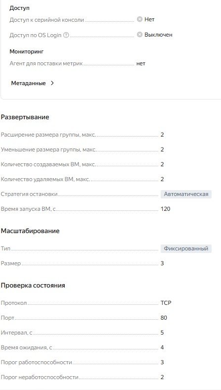

3. Подключаем группу к сетевому балансировщику:

 - создаем сетевой балансировщик [Сетевой блансировщик](./conf/load-balancer.tf)

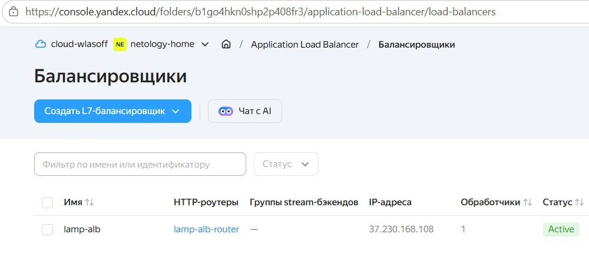

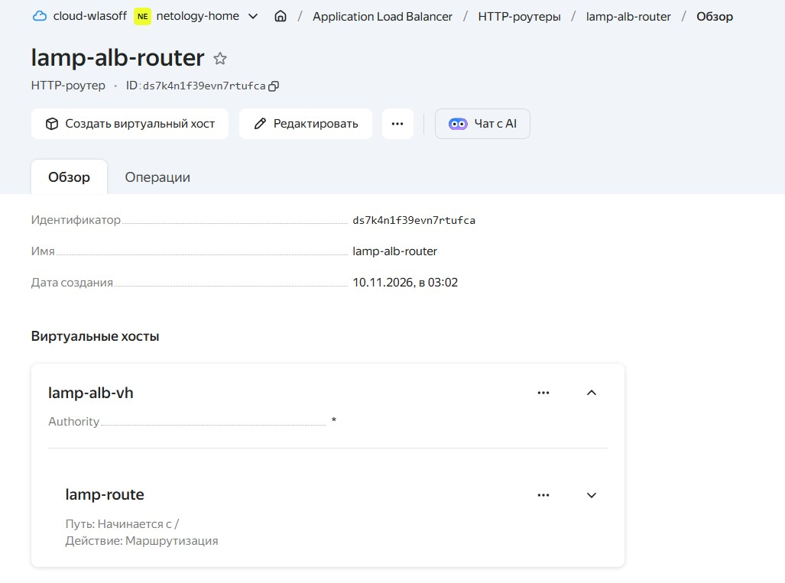

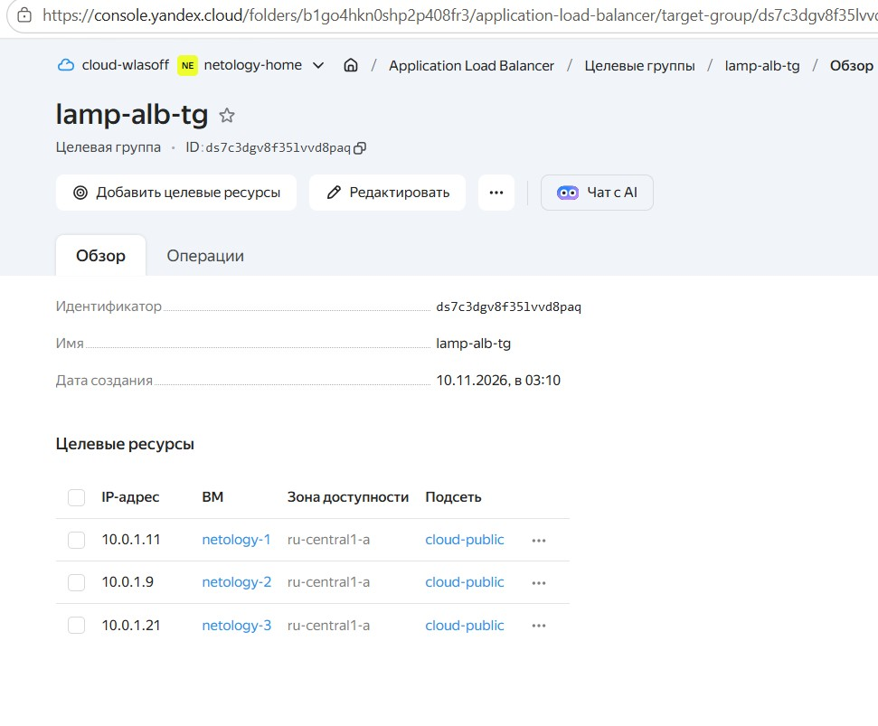

 - проверяем работоспособность, удалив одну или несколько ВМ

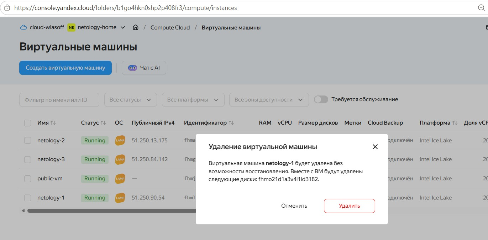

ВМ удаляется

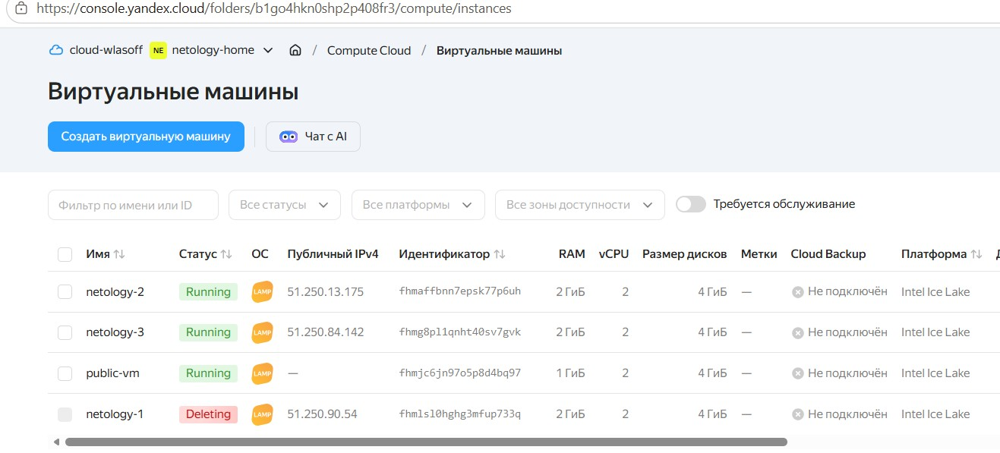

Пропал публичный IP у ВМ

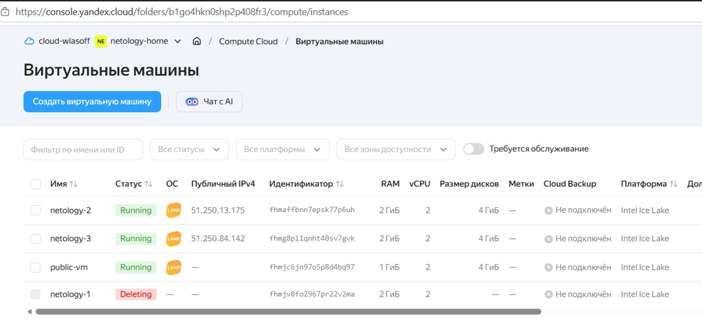

Нет доступа к сайту по http://51.250.90.54/

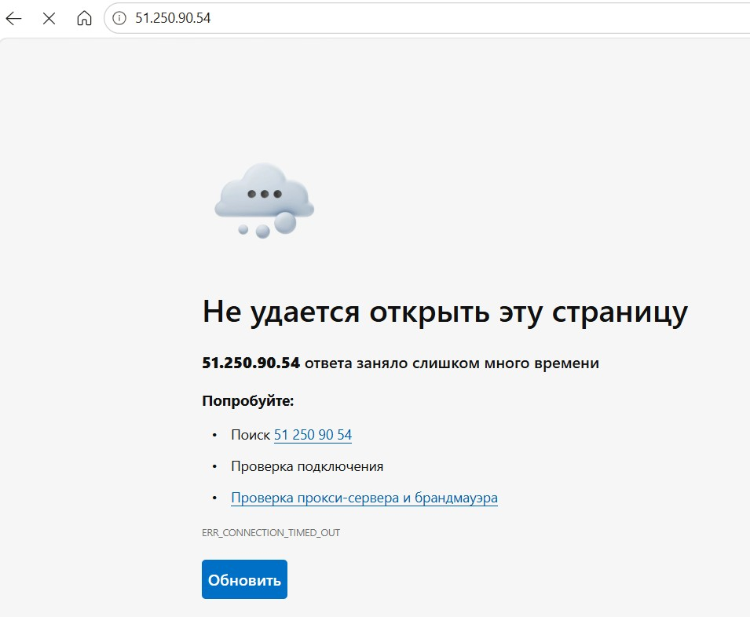

ВМ пересоздается с новым публичным IP 51.250.80.7:

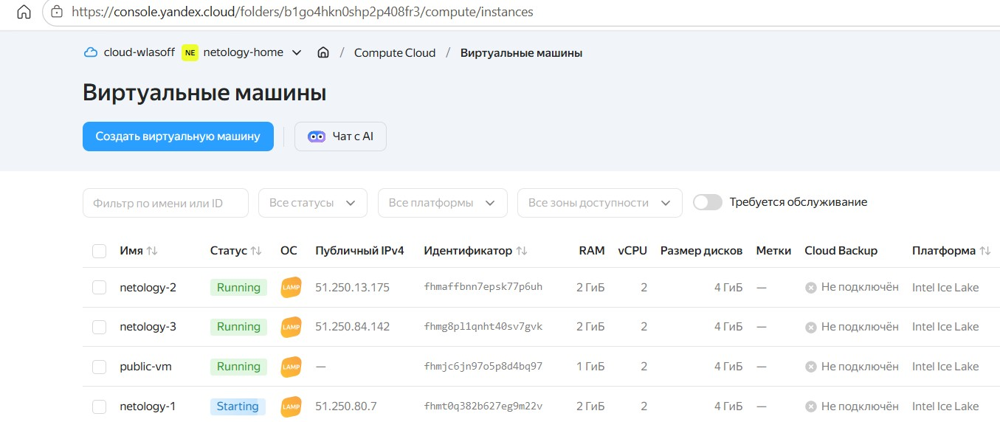

Появился доступ к сайту по новому адресу http://51.250.80.7/


[<Файлы для terraform>](./cfg/)

Удаляем все ресурсы на yc командой

```bash
 terraform destroy
   ```
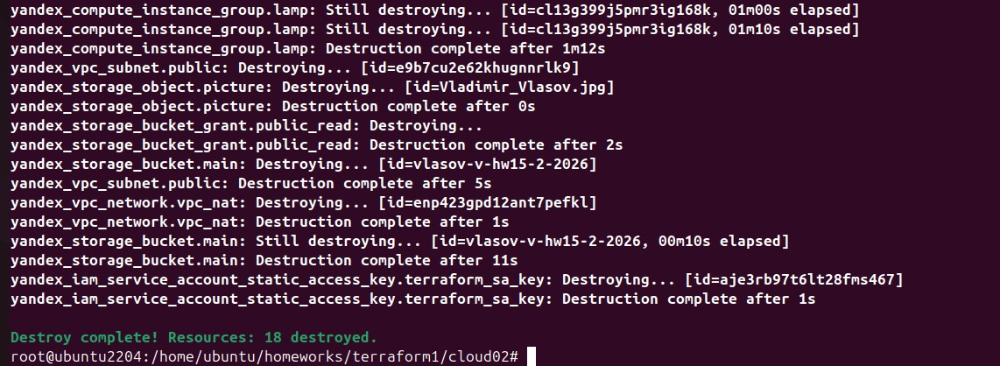


